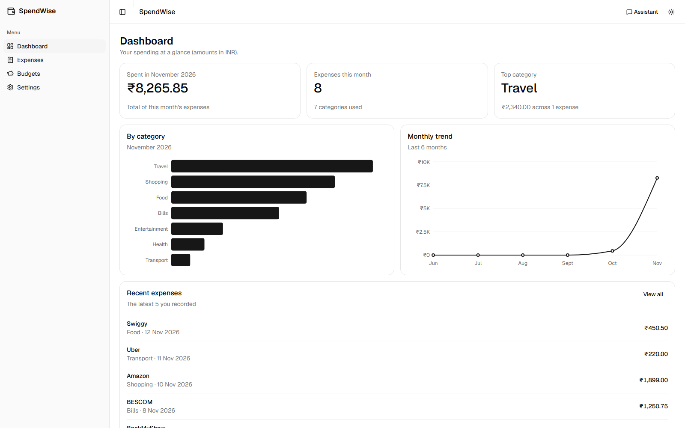
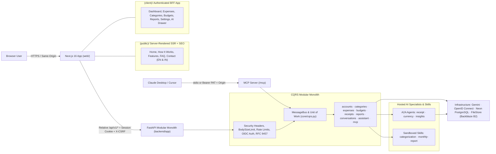

# trackwise.ai

**trackwise.ai** is a full-stack, multi-tenant expense tracking, budgeting, and AI financial assistant platform built with a **Modular Monolith** backend (**FastAPI**, **CQRS-lite**, **Neon PostgreSQL**) and a **Next.js 16 App Router** web application featuring a server-rendered bilingual SaaS site (`en` / `hi`) and an interactive workspace powered by **AG-UI**, **A2UI**, **MCP**, **Agent Skills**, and **A2A agents**.


-4169E1?logo=postgresql&logoColor=white)




---

## Overview

- **Modular Monolith (`backend/`):** Nine domain modules communicate through public module contracts (`__init__.py`) and a typed CQRS `MessageBus`, with cross-module database joins forbidden and automated rule checks enforced in CI (`backend/scripts/check_rules.py`).
- **Multi-Protocol AI Architecture:** Combines **AG-UI** event streaming, server-validated **A2UI** interactive cards/charts/forms, an embedded/HTTP **MCP** server for user-scoped AI client access, **Agent Skills** with isolated `python -I` report computation, and three **A2A** specialist agents (`receipt`, `currency`, `insights`) hosted in-process on `main`.
- **Security by Construction:** Backend-for-Frontend (**BFF**) OIDC authentication with `HttpOnly` / `SameSite=Strict` session cookies and CSRF checks, `owner_id` scoping on every owned query and mutation, streaming request-body size limits, database-backed destructive action approvals, and localized **RFC 9457** errors that never leak internal exceptions or third-party error strings.
- **Public Website & SEO (`web/`):** Server-rendered global marketing routes (`/`, `/how-it-works`, `/features`, `/faq`, `/contact`, and `/hi/...` mirrors) in plain consumer language, plus `/privacy-policy` and `/terms-of-service` for onboarding consent and sign-in, with `hreflang` alternates, JSON-LD structured data, dynamic Open Graph images, custom vector/adaptive favicons, and an interactive walkthrough player alongside the client-rendered workspace.

---

## Core Capabilities

| Area | Built Features |
|---|---|
| **Public Website** | Bilingual server-rendered pages (`en` & `/hi`), 4-scene animated walkthrough player, route-transition progress bar, dynamic OG cards, sitemap/robots/manifest, 308 redirects (`/security` -> `/faq`), and JSON-LD (`Organization`, `WebSite`, `SoftwareApplication`, `HowTo`, `FAQPage`, `BreadcrumbList`). |
| **Expense & Budget Workspace** | KPI Dashboard (`/dashboard`), paginated/filtered ledger (`/expenses`), shared categories breakdown (`/categories`), overall & per-category monthly limits with live 80%/100% alert notices (`/budgets`), CSV/Markdown monthly exports (`/reports`), `Ctrl/⌘ + K` command palette, and server-stored onboarding welcome & terms acceptance. |
| **Streaming AI Assistant** | Natural-language expense logging, editable confirmation forms, DB-persisted delete approvals, streaming AG-UI timeline, interactive A2UI spending charts/cards, and conversation history synced with workspace queries. |
| **Receipt Scanning** | Multipart upload validated by magic bytes -> delegated to the `receipt` A2A agent -> structured extraction presented as an editable card before any row is saved. |
| **Multi-Currency & Insights** | All expenses store original currency plus server-computed `BigInteger` INR (`base_amount_minor`) via the `currency` A2A agent; spending recommendations come from deterministic aggregations + the `insights` A2A agent. |
| **External MCP Clients** | Standard MCP tools exposed over stdio or Streamable HTTP with `Origin` validation and revocable Personal Access Tokens (`spw_` prefix, SHA-256 hashed) managed in `/settings`. |

---

## System Architecture



For deeper diagrams and boundary rules, see [How trackwise.ai Works](docs/how_trackwise_works.md), [Architecture](docs/architecture.md), and [Assistant Architecture](docs/assistant_architecture.md).

---

## Engineering Highlights

1. **Enforced Boundaries (`backend/scripts/check_rules.py`):** 14 static rules verify layered imports (`core/` -> nowhere, `infrastructure/` & `web/` -> `core/` only), one-way module dependencies, zero cross-module table queries, injected clocks instead of `date.today()`, mandatory `owner_id` filtering (zero unscoped `session.get()` calls on owned tables), and strict isolation of LLM and file-storage vendor adapters.
2. **Generated Full-Stack Contracts:** [`backend/scripts/export_contracts.py`](backend/scripts/export_contracts.py) exports FastAPI's OpenAPI specification (`web/openapi.json`) and shared enums/limits/A2UI/AG-UI constants (`contracts.gen.ts`), and `npm run gen:api` generates `schema.gen.ts` for compile-time typed `openapi-fetch` queries.
3. **Untrusted Data & AI Guardrails:** Receipts and LLM extractions are treated as untrusted data (no tools allowed during image extraction, Pydantic `model_validate`, allow-listed categories/payment methods), A2UI trees enforce strict depth (`<= 12`), component count (`<= 300`), and safe client actions, and CSV exports sanitize formula triggers (`=`, `+`, `-`, `@`).
4. **Full Localization (`en` / `hi`):** Both the React UI (`i18next` lazy namespaces typed against `en.ts`) and server-generated cards, tool chips, and RFC 9457 error details (`Accept-Language` + Babel CLDR money/date formatting) stay aligned.
5. **100% Seam-Driven Testability:** `bootstrap.build(clock, llm, tools, engine, files, identity, sealer, agents, skills, settings)` accepts fakes/in-memory engines without monkeypatching.

---

## Documentation Index

| Area | Document | What It Covers |
|---|---|---|
| **Product** | [Product Overview](docs/overview.md) | Workspace views, public pages, AI capabilities, and current scope |
| **Product** | [How trackwise.ai Works](docs/how_trackwise_works.md) | Visual flowcharts for web UX, chat/approvals, receipts, A2A agents, and MCP |
| **Product** | [Roadmap](docs/roadmap.md) | Completed phases and planned extensions (recurring expenses, multi-currency, billing) |
| **Architecture** | [Architecture](docs/architecture.md) | Modular monolith layers, CQRS bus, vertical slices, feature slices, and 14 scans |
| **Architecture** | [Assistant Architecture](docs/assistant_architecture.md) | AG-UI loop, A2UI surfaces, approvals, A2A delegation, and Agent Skills |
| **Architecture** | [Architecture Decisions (ADRs)](docs/decisions.md) | Key technical choices and trade-offs (`D1–D221`) |
| **Security** | [Security Architecture](docs/security.md) | BFF sessions, OIDC, BOLA/IDOR isolation, A2A/MCP hardening, A2UI safety, and CSP |
| **API & Data** | [API Reference](docs/api_endpoints.md) | REST `/api/v1`, `/mcp`, OIDC routes, streaming chat, and RFC 9457 problems |
| **API & Data** | [Database Schema](docs/database_schema.md) | 9 tables (`0001`–`0012`), `BigInteger` money storage, and module ownership |
| **Setup** | [Getting Started](docs/getting_started.md) | Environment setup, Neon PostgreSQL, migrations, seed data, and MCP clients |
| **Setup** | [Configuration](docs/configuration.md) | `.env` reference, timeouts, quotas, upload limits, and rate limits |
| **Setup** | [Identity Provider Setup](docs/identity_provider.md) | OIDC configuration (ZITADEL / Keycloak / Authentik) and switching providers |
| **Contributing** | [Backend Onboarding](docs/backend_onboarding.md) · [Frontend Onboarding](docs/frontend_onboarding.md) | Vertical slice and React feature-slice implementation recipes + [AGENTS.md](AGENTS.md) |

---

## Quick Start

> **Prerequisites:** Python 3.11+, Node.js 20+, a PostgreSQL connection string (e.g. Neon), a Gemini API key, and an OpenID Connect provider. Full step-by-step instructions live in [Getting Started](docs/getting_started.md).

### 1. Configure Environment & Seed Database

```powershell
Copy-Item .env.example .env
# Populate DATABASE_URL, GEMINI_API_KEY, SESSION_ENCRYPTION_KEYS, OIDC_*, and B2_* values in .env

python -m venv .venv
.\.venv\Scripts\pip.exe install -r requirements.txt
.\.venv\Scripts\python.exe -m alembic -c backend\alembic.ini upgrade head
.\.venv\Scripts\python.exe backend\seed.py
```

### 2. Start Backend & Web App

```powershell
# Terminal 1: FastAPI backend + hosted A2A agents + optional /mcp
.\run.ps1

# Terminal 2: Next.js 16 dev server
cd web
npm install
npm run dev
```

### 3. Run Verification Suite

Install dev dependencies (`pip install -r requirements-dev.txt`), then run all 9 Python, architecture, lint, format, type, and Next.js production build checks:

```powershell
.\.venv\Scripts\python.exe backend\scripts\check.py
```

---

## Local Access Points

| Surface | URL | Purpose |
|---|---|---|
| **Web App & Public Site** | `http://localhost:5173` | Public website (`/`), Dashboard (`/dashboard`), and Workspace |
| **FastAPI API & Swagger** | `http://127.0.0.1:8000/docs` | OpenAPI docs and `/api/v1/*` endpoints |
| **Health Probe** | `http://127.0.0.1:8000/health` | Database, schema revision, and hosted agents readiness check |
| **Streamable HTTP MCP** | `http://127.0.0.1:8000/mcp/` | External AI client endpoint using a Personal Access Token |

---

## Repository Layout

```text
trackwise.ai/
├── AGENTS.md                         # Engineering standards & agent contract
├── requirements.txt                  # Pinned backend runtime dependencies
├── requirements-dev.txt              # Pinned Ruff & Pyright checks
├── run.ps1                           # Local dev launcher (venv, Alembic upgrade, Uvicorn)
├── backend/
│   ├── alembic.ini                   # Alembic configuration
│   ├── seed.py                       # Seeds the 8 shared expense categories
│   ├── mcp_stdio.py                  # Stdio MCP transport entrypoint
│   ├── migrations/versions/          # 0001_baseline .. 0012_user_onboarding_and_terms
│   ├── scripts/                      # check.py (9 CI gates), check_rules.py, export_contracts.py
│   └── app/
│       ├── core/                     # CQRS bus, errors, money/month/clock primitives, ports
│       ├── infrastructure/           # Gemini LLM, A2A client, OIDC, Fernet, Neon DB, FileStore (storage/b2)
│       ├── web/                      # Auth deps, CSRF, BodySizeLimit, rate limits, security headers
│       ├── modules/                  # accounts, assistant, budgets, categories, conversations,
│       │                             # expenses, mcp, receipts, reports
│       ├── agents_host.py            # In-process A2A mounting for main branch
│       ├── bootstrap.py              # Composition root (DI assembly)
│       └── main.py                   # FastAPI factory & route registration
├── agents/                           # Standalone A2A agents & shared agent_kit
│   ├── agent_kit/                    # Auth gate, ForgetfulTaskStore, card builders
│   ├── currency/                     # FX rate lookup agent
│   ├── insights/                     # Structured numbers + Gemini tips agent
│   └── receipt/                      # Multimodal receipt extraction agent
├── skills/                           # Runtime Agent Skills (agentskills.io)
│   ├── categorization/               # Merchant/purchase classification instructions
│   └── monthly-report/               # Report skill + isolated Python computation script
├── web/                              # Next.js 16 (App Router) + React 19 + Tailwind 4
│   └── src/
│       ├── app/                      # (public) SSR/SEO site, (client) BFF shell, _frame, _seo, _shell
│       ├── features/                 # account, assistant, auth, budgets, categories, dashboard,
│       │                             # expenses, reports
│       └── shared/                   # openapi-fetch client, generated contracts, formatting, UI kit
└── docs/                             # Curated technical, security, API & product documentation
```
