# Database Schema

trackwise.ai uses one Neon PostgreSQL database configured by the required `DATABASE_URL`. Each table belongs to
**exactly one module**, and only that module reads or writes it. SQLite is retained only for explicitly created,
isolated checks; the app does not create a local database file.

## Tables at a glance

```mermaid
erDiagram
    category {
        BIGINT id PK
        VARCHAR_50 name "unique"
        VARCHAR_50 name_key "unique, case-folded"
        VARCHAR_50 icon
    }
    expense {
        BIGINT id PK
        BIGINT owner_id "the person; indexed with spent_on"
        BIGINT amount_minor "minor units (scaled by 100)"
        VARCHAR_3 currency
        BIGINT category_id "indexed, no foreign key"
        VARCHAR_100 merchant
        VARCHAR_500 note "nullable"
        DATE spent_on "indexed"
        VARCHAR_20 payment_method
        DATETIME created_at "UTC, with time zone"
        INTEGER version "starts at 1"
        BIGINT base_amount_minor "base-currency minor units, nullable"
        VARCHAR_32 exchange_rate "nullable"
        DATE rate_date "nullable"
    }
    conversation_message {
        BIGINT id PK
        BIGINT owner_id "the person; indexed with thread_id, turn"
        VARCHAR_32 thread_id
        INTEGER turn
        VARCHAR_30 kind
        JSON content "a provider-neutral message"
        DATETIME created_at
    }
    budget {
        BIGINT id PK
        BIGINT owner_id "the person; unique with category_id"
        BIGINT category_id "nullable: null is the overall budget"
        BIGINT limit_minor "minor units, monthly"
        DATETIME updated_at "UTC"
    }
    pending_approval {
        VARCHAR_64 approval_id PK "the card's surface id"
        BIGINT owner_id "the person; indexed"
        VARCHAR_32 thread_id "indexed"
        JSON expense "snapshot shown on the card"
        DATETIME created_at "indexed"
    }
    pending_delegation {
        BIGINT owner_id PK "the person; PK with thread_id"
        VARCHAR_32 thread_id PK
        VARCHAR_32 agent
        VARCHAR_64 skill
        VARCHAR_64 task_id
        VARCHAR_64 context_id
        DATETIME created_at "indexed"
    }
    receipt_file {
        BIGINT id PK
        BIGINT owner_id "the person; indexed"
        VARCHAR_32 storage_key "unique; object key in Backblaze B2"
        VARCHAR_15 media_type "read from the file's bytes"
        INTEGER size_bytes
        DATETIME created_at "UTC, with time zone"
    }
    app_user {
        BIGINT id PK "trackwise.ai's own id for a person"
        VARCHAR_200 name "as the provider last said"
        VARCHAR_320 email
        BOOLEAN email_verified
        VARCHAR_2048 avatar_url "https only"
        BOOLEAN is_active
        VARCHAR_10 preferred_language "'en' by default"
        VARCHAR_3 default_currency "'USD' by default"
        VARCHAR_64 timezone "'UTC' by default; IANA zone"
        DATETIME welcomed_at "nullable; first-run welcome"
        VARCHAR_32 terms_version "nullable; accepted version"
        DATETIME terms_accepted_at "nullable"
        DATETIME created_at
        DATETIME updated_at
    }
    user_identity {
        BIGINT id PK
        BIGINT user_id FK "indexed"
        VARCHAR_255 issuer "unique with subject"
        VARCHAR_255 subject
        VARCHAR_320 email "when first seen"
        DATETIME created_at
    }
    user_session {
        BIGINT id PK
        VARCHAR_64 key_hash "unique; SHA-256 of the cookie's key"
        VARCHAR_32 handle "unique; the sign-out link's sid"
        BIGINT user_id FK "indexed"
        VARCHAR_255 issuer
        VARCHAR_255 provider_session_id "indexed; OIDC sid"
        TEXT sealed_id_token "encrypted; cleared on revoke"
        DATETIME created_at
        DATETIME renewed_at
        DATETIME expires_at "indexed; idle"
        DATETIME absolute_expires_at
        DATETIME revoked_at "nullable"
        VARCHAR_255 user_agent "nullable"
    }
    login_attempt {
        BIGINT id PK
        VARCHAR_64 key_hash "unique"
        VARCHAR_64 state
        VARCHAR_64 nonce
        VARCHAR_128 code_verifier
        VARCHAR_2048 return_to
        DATETIME created_at "indexed"
    }
    access_token {
        BIGINT id PK
        BIGINT user_id FK "indexed"
        VARCHAR_50 name
        VARCHAR_64 token_hash "unique; SHA-256 of the token"
        VARCHAR_4 hint "its last characters"
        DATETIME created_at
        DATETIME expires_at
        DATETIME last_used_at "nullable"
    }
    split_profile {
        BIGINT owner_id PK
        VARCHAR_100 upi_id "nullable; syntax-validated only"
        BOOLEAN share_upi_with_groups "false by default"
        DATETIME updated_at
    }
    split_contact {
        BIGINT id PK
        BIGINT owner_id "indexed"
        VARCHAR_80 name
        VARCHAR_80 name_key "unique with owner_id"
        VARCHAR_100 upi_id "nullable; private to owner"
        VARCHAR_200 note "nullable"
        DATETIME archived_at "nullable"
        DATETIME created_at
    }
    split_group {
        BIGINT id PK
        BIGINT owner_id "current owner UserId; indexed"
        VARCHAR_16 kind "'personal' or 'shared'"
        VARCHAR_80 name
        VARCHAR_80 name_key "unique with owner_id"
        VARCHAR_3 default_currency "nullable"
        DATETIME archived_at "nullable"
        DATETIME created_at
    }
    split_group_member {
        BIGINT id PK
        BIGINT group_id FK "indexed; unique with user_id / contact_id"
        BIGINT user_id "nullable; registered member UserId"
        BIGINT contact_id FK "nullable; private contact/guest seat"
        VARCHAR_80 display_name
        VARCHAR_16 role "'owner' or 'member'"
        BIGINT added_by_user_id
        DATETIME joined_at
        DATETIME left_at "nullable; cleared on rejoin"
    }
    split_group_invite {
        BIGINT id PK
        BIGINT group_id FK "indexed"
        BIGINT created_by_user_id
        VARCHAR_64 token_hash "unique; SHA-256 of spwi_ token"
        VARCHAR_4 hint "last characters"
        BIGINT target_member_id FK "nullable; specific guest seat"
        INTEGER max_uses ">= 1"
        INTEGER use_count "0..max_uses"
        DATETIME expires_at "indexed"
        DATETIME revoked_at "nullable"
        DATETIME created_at
    }
    split_expense {
        BIGINT id PK
        BIGINT owner_id "indexed; creator/owner"
        BIGINT group_id FK "nullable; null for direct splits"
        VARCHAR_120 description
        BIGINT amount_minor "> 0"
        VARCHAR_3 currency
        BIGINT paid_by_member_id FK "nullable"
        BIGINT paid_by_contact_id FK "nullable"
        VARCHAR_20 split_method "'equal' or 'exact'"
        DATE spent_on
        VARCHAR_500 note "nullable"
        DATETIME created_at
    }
    split_share {
        BIGINT id PK
        BIGINT split_expense_id FK "indexed"
        BIGINT member_id FK "nullable"
        BIGINT contact_id FK "nullable; both null = direct owner share"
        BIGINT share_minor ">= 0"
    }
    split_settlement {
        BIGINT id PK
        BIGINT owner_id "indexed"
        BIGINT group_id FK "nullable"
        BIGINT from_member_id FK "nullable"
        BIGINT to_member_id FK "nullable"
        BIGINT from_contact_id FK "nullable"
        BIGINT to_contact_id FK "nullable"
        BIGINT amount_minor "> 0"
        VARCHAR_3 currency
        DATE settled_on
        VARCHAR_200 note "nullable"
        DATETIME voided_at "nullable; soft-void"
        BIGINT voided_by_user_id "nullable"
        DATETIME created_at
    }
    split_expense_link {
        BIGINT id PK
        BIGINT split_expense_id FK "unique with owner_id"
        BIGINT owner_id "indexed"
        BIGINT expense_id "nullable while recording; no FK"
        VARCHAR_16 status "'recording' or 'linked'"
        DATETIME created_at
        DATETIME updated_at
    }
    category ||..o{ expense : "category_id (checked in code)"
    app_user ||--o{ user_identity : "user_id"
    app_user ||--o{ user_session : "user_id"
    app_user ||--o{ access_token : "user_id"
    split_group ||--o{ split_group_member : "group_id"
    split_group ||--o{ split_group_invite : "group_id"
    split_group ||--o{ split_expense : "group_id"
    split_group ||--o{ split_settlement : "group_id"
    split_expense ||--o{ split_share : "split_expense_id"
    split_expense ||--o{ split_expense_link : "split_expense_id"
    expense ||..o{ split_expense_link : "expense_id (checked in code)"
```



The dotted line is a link kept **in code**, not by the database: there are no foreign keys between modules (below).
`pending_approval.thread_id`, `pending_delegation.thread_id` and `conversation_message.thread_id` name the same
conversations, also without a key.

| Table | Owner module | Holds |
|---|---|---|
| `category` | categories | the spending categories |
| `expense` | expenses | every expense |
| `budget` | budgets | standing monthly limits, overall and per category |
| `conversation_message` | conversations | chat history, one row per message |
| `pending_approval` | assistant | delete cards waiting for Approve or Cancel |
| `pending_delegation` | assistant | A2A agent tasks waiting for the person's follow-up answer |
| `receipt_file` | receipts | uploaded receipts (the files themselves are in Backblaze B2, not the database) |
| `app_user` | accounts | the people who use trackwise.ai, by trackwise.ai's own id |
| `user_identity` | accounts | how each person signs in: a provider (issuer) and their id there (subject) |
| `user_session` | accounts | signed-in browsers: the hash of each cookie's key, and the session's lifetimes |
| `login_attempt` | accounts | sign-ins that have left for the provider and not come back yet |
| `access_token` | accounts | personal access tokens for MCP clients: the hash of each, never the token |
| `split_profile` | splits | optional per-user UPI receive ID and opt-in group-sharing toggle (D226) |
| `split_contact` | splits | a person's private contacts for direct 1-on-1 splits and Personal/guest seats |
| `split_group` | splits | unified Personal (single-owner) and Shared (multi-owner) split groups |
| `split_group_member` | splits | registered members and guest/placeholder seats inside a group (reactivated on rejoin) |
| `split_group_invite` | splits | SHA-256 hashed, expiring, revocable invite links for Shared groups |
| `split_expense` | splits | group or direct split ledger entries with currency and split method |
| `split_share` | splits | per-participant minor-unit obligation rows for each `split_expense` |
| `split_settlement` | splits | auditable, soft-voidable full/partial repayments between participants |
| `split_expense_link` | splits | strictly private per-user mapping from a split to that user's own `expense.id` |
| `alembic_version` | (migrations) | which migration the database is at |

## `category`

| Column | Type | Notes |
|---|---|---|
| `id` | BIGINT, primary key | |
| `name` | VARCHAR(50), not null | unique index `ix_category_name` |
| `name_key` | VARCHAR(50), not null | unique index `ix_category_name_key`: trimmed, case-folded `name`, so names that differ only in letter case ("food" vs "Food") are rejected by the database too (D216) |
| `icon` | VARCHAR(50), not null | an icon *name* (`utensils`), mapped to a picture by the web app |

## `expense`

| Column | Type | Notes |
|---|---|---|
| `id` | INTEGER, primary key | shown everywhere as `#14` |
| `owner_id` | INTEGER, not null | whose expense it is (trackwise.ai's user id, no foreign key: D13). Every read and change filters on it (D190); the index `ix_expense_owner_id_spent_on` (owner_id, spent_on) serves "my expenses this month" |
| `amount_minor` | INTEGER, not null | **whole minor units**: `$24.50` is `2450`. Never a float |
| `currency` | VARCHAR(3), not null | ISO 4217 code, default `USD` (`DEFAULT_CURRENCY`) |
| `category_id` | INTEGER, not null | index `ix_expense_category_id`. **No foreign key**: the expenses module asks the categories module whether the category exists |
| `merchant` | VARCHAR(100), not null | trimmed of spaces |
| `note` | VARCHAR(500), nullable | |
| `spent_on` | DATE, not null | second column of `ix_expense_owner_id_spent_on` |
| `payment_method` | VARCHAR(20), not null | `cash`, `upi`, `card`, `netbanking`, `wallet` or `other` |
| `created_at` | DATETIME with time zone, not null | UTC, set from the app's clock |
| `version` | INTEGER, not null, default 1 | raised by one on every update: **optimistic concurrency** |
| `base_amount_minor` | INTEGER, nullable | the same amount in `BASE_CURRENCY` (`USD`, D204/D223), whole minor units: what totals add up. Equal to `amount_minor` for `BASE_CURRENCY` |
| `exchange_rate` | VARCHAR(32), nullable | the rate it was converted at, exactly, as text (`"1.06"`; `"1"` for `BASE_CURRENCY`) |
| `rate_date` | DATE, nullable | the day the rate is for (the expense's date, or the nearest earlier day the rates have) |

The three are null only for an expense in another currency saved before migration 0008: it's left out of totals
until a new amount, currency or date converts it.

### Why `version`

The assistant's Approve card shows an expense and later deletes it. If the expense was edited in between (from the
table, another tab, an MCP client), deleting it would remove something the user never saw. So the delete is one
statement:

```sql
DELETE FROM expense WHERE id = :id AND owner_id = :owner AND version = :version_on_the_card
```

If it deletes nothing, the expense changed (or is gone), and the user is told so. No lock is held while waiting for
the user, and nothing can slip in between the check and the delete.

## `conversation_message`

| Column | Type | Notes |
|---|---|---|
| `id` | INTEGER, primary key | also the order of messages |
| `owner_id` | INTEGER, not null | whose conversation it is. A thread is (owner_id, thread_id): the same id from two people is two conversations (D190) |
| `thread_id` | VARCHAR(32), not null | with `owner_id` and `turn`, the index `ix_conversation_message_owner_id_thread_id_turn`: every read of a thread filters on all three |
| `turn` | INTEGER, not null | 1 for the first user message of a thread, 2 for the next, … Only the last 10 turns are resent to the model |
| `kind` | VARCHAR(30), not null | `user_text`, `assistant_text`, `tool_call`, `tool_result` or `reasoning` (also inside `content`) |
| `content` | JSON, not null | the message, in trackwise.ai's own format, not any provider's |
| `created_at` | DATETIME with time zone, not null | |

What `content` looks like for each kind:

```json
{"kind": "user_text", "text": "Add 25 USD for lunch at Subway"}
{"kind": "assistant_text", "text": "Saved $25.00 at Subway."}
{"kind": "tool_call", "call_id": "c1", "name": "add_expense", "arguments": {"amount": "25", "merchant": "Subway"}}
{"kind": "tool_result", "call_id": "c1", "name": "add_expense", "output": "{…}", "is_error": false}
{"kind": "reasoning", "provider": "gemini", "opaque": {"signature": "c2ln…"}}
```

A turn is written in one transaction once it has finished, so a thread never holds half a turn. `reasoning` keeps a
provider's private data (Gemini's thought signature, needed to continue after a tool call) for that provider only.

## `pending_approval`

| Column | Type | Notes |
|---|---|---|
| `approval_id` | VARCHAR(64), primary key | the Approve/Cancel card's surface id, what the browser sends back |
| `owner_id` | INTEGER, not null | index; only the card's owner can answer it |
| `thread_id` | VARCHAR(32), not null | index; a card can only be answered in its own conversation |
| `expense` | JSON, not null | the expense exactly as the card showed it, including its `version` |
| `created_at` | DATETIME with time zone, not null | index; cards expire after 15 minutes |

At most 200 are kept per person (their oldest forgotten first). Taking a card removes it, so each card decides once; if the decision
fails midway, the card is put back unchanged (same age).

## `pending_delegation`

A remote agent's task waiting for the person's answer (Phase 25, D206): one per conversation. Private to the
assistant module.

| Column | Type | Notes |
|---|---|---|
| `owner_id`, `thread_id` | INTEGER, VARCHAR(32); together the primary key | whose conversation: only their next message there answers it (D190) |
| `agent`, `skill` | VARCHAR(32), VARCHAR(64) | the app's name for the agent, and the skill (`insights`, `analyze_spending`) |
| `task_id`, `context_id` | VARCHAR(64) | the A2A ids to resume the task with (checked to look like ids) |
| `created_at` | DATETIME with time zone, indexed | forgotten 15 minutes later; at most 50 per person |

## `budget`

A person's monthly limits (Phase 27, D210): one per category, and one overall. Private to the budgets module. Only
limits are stored: what was spent always comes from the `expense` table, through the expenses module.

| Column | Type | Notes |
|---|---|---|
| `id` | INTEGER, primary key | |
| `owner_id` | INTEGER, not null | whose budget (D190); every read and change names it |
| `category_id` | INTEGER, nullable | the category (no foreign key, checked through the categories module), or null for the overall budget |
| `limit_minor` | INTEGER, not null | the monthly limit in base-currency minor units (`USD`, D223), the same every month until changed; above 0 |
| `updated_at` | DATETIME with time zone, not null | when the limit was last set (UTC) |

**One budget per scope.** A unique index `uq_budget_owner_id_category_id` on `(owner_id, category_id)`; since SQL
treats NULLs as distinct, a partial unique index `uq_budget_owner_id_overall` on `owner_id` where `category_id IS NULL`
allows one overall budget per person (migration 0010; Postgres supports the same partial index).

## `receipt_file`

| Column | Type | Notes |
|---|---|---|
| `id` | INTEGER, primary key | the receipt's id (`POST /receipts` answers it) |
| `owner_id` | INTEGER, not null | index; who uploaded it: only they can see it, have it read or attach it |
| `storage_key` | VARCHAR(32), unique, not null | where the bytes are: a random key (a UUID's hex digits) the `FileStore` made, never a name the user sent |
| `media_type` | VARCHAR(15), not null | `image/jpeg`, `image/png`, `image/webp` or `application/pdf`, read from the file's first bytes |
| `size_bytes` | INTEGER, not null | at most 5 MB |
| `created_at` | DATETIME with time zone, not null | when it was uploaded (UTC) |

**The bytes aren't in the database.** A receipt can be megabytes; the database keeps the row, and the file is kept in
a private Backblaze B2 bucket under its key (D181, D221). The upload saves the file first and deletes it again if the
row can't be added, so there's never a file without a row. Nothing deletes receipts yet.

## The accounts tables

Owned by the accounts module (Phase 22, D186, D187). The solid lines are real foreign keys: they stay inside the
module, which D13 allows (it forbids them between modules).

### `app_user`

| Column | Type | Notes |
|---|---|---|
| `id` | INTEGER, primary key | trackwise.ai's own id for the person: what every other module's `owner_id` points at (D190), whatever provider they use |
| `name`, `email`, `email_verified`, `avatar_url` | VARCHAR(200), VARCHAR(320), BOOLEAN, VARCHAR(2048) | the profile as the provider said at the last sign-in; never used to find a person. A picture is kept only as an http(s) URL |
| `is_active` | BOOLEAN, not null | trackwise.ai's own off switch: off, the person can't sign in and their sessions stop working |
| `preferred_language` | VARCHAR(10), not null | `'en'` by default; persisted preference (`en`, `hi`) across sessions and surfaces |
| `default_currency` | VARCHAR(3), not null | `'USD'` by default; ISO 4217 currency preference for the user |
| `timezone` | VARCHAR(64), not null | `'UTC'` by default; IANA time zone name (`America/New_York`, `Asia/Kolkata`, ...) validated via `zoneinfo` |
| `welcomed_at` | DATETIME with time zone, nullable | when the person finished (or skipped) the first-run welcome flow (Phase 29, D220) |
| `terms_version`, `terms_accepted_at` | VARCHAR(32), DATETIME with time zone, nullable | which Terms of Service and Privacy Policy version the person accepted, and when |
| `created_at`, `updated_at` | DATETIME with time zone | UTC, from the app's clock |

### `user_identity`

| Column | Type | Notes |
|---|---|---|
| `user_id` | INTEGER, foreign key to `app_user.id` | indexed |
| `issuer`, `subject` | VARCHAR(255) each | **unique together**: the provider and the person's id there. How a person is found at sign-in; never by email (D187) |
| `email` | VARCHAR(320), nullable | the email when this identity was first seen, as a record |

A person can have several identities: that's how a later switch of provider can keep them the same person
([identity_provider.md](identity_provider.md#switching-providers)).

### `user_session`

| Column | Type | Notes |
|---|---|---|
| `key_hash` | VARCHAR(64), unique | SHA-256 of the cookie's random key; the key itself is never stored |
| `handle` | VARCHAR(32), unique | a random public name for the session; the sign-out link carries it |
| `user_id` | INTEGER, foreign key to `app_user.id` | indexed |
| `issuer` | VARCHAR(255) | the provider it was signed in with; a session from another provider isn't accepted |
| `provider_session_id` | VARCHAR(255), nullable, indexed | the provider's session (OIDC `sid`), for back-channel logout |
| `sealed_id_token` | TEXT, nullable | the ID token, encrypted with `SESSION_ENCRYPTION_KEYS` (Fernet); signing out names it to the provider |
| `renewed_at`, `expires_at` | DATETIME | renewed while used (written at most every 12 h); `expires_at` (indexed) is a day after the last renewal |
| `absolute_expires_at` | DATETIME | 14 days after sign-in, whatever happens |
| `revoked_at` | DATETIME, nullable | set by signing out, a new sign-in in the same browser, the provider's back-channel logout, or signing it out from Settings |
| `user_agent` | VARCHAR(255), nullable | the browser's User-Agent at sign-in, so the person can tell their sessions apart; shown only to them |

A session is live when it isn't revoked, both expiries are in the future, its issuer is today's provider's, and its
user is active: all checked in one query. Ended sessions are deleted at the next sign-in.

### `login_attempt`

| Column | Type | Notes |
|---|---|---|
| `key_hash` | VARCHAR(64), unique | SHA-256 of the login cookie's key: the attempt completes only in the browser that started it |
| `state`, `nonce`, `code_verifier` | VARCHAR(64), VARCHAR(64), VARCHAR(128) | what the callback checks the provider's answer against |
| `return_to` | VARCHAR(2048) | the web app's page to come back to, already checked |
| `created_at` | DATETIME, indexed | attempts over 10 minutes old are forgotten; at most 500 are kept |

Each attempt is read and deleted in one step when the provider sends the browser back, so it completes once.

### `access_token`

| Column | Type | Notes |
|---|---|---|
| `user_id` | INTEGER, foreign key to `app_user.id` | indexed; whose token it is |
| `name` | VARCHAR(50) | what its owner called it |
| `token_hash` | VARCHAR(64), unique | SHA-256 of the token; the token itself is shown once and never stored (D191) |
| `hint` | VARCHAR(4) | its last characters, shown in Settings |
| `created_at`, `expires_at` | DATETIME | it stops working at `expires_at`; revoking deletes the row |
| `last_used_at` | DATETIME, nullable | written at most once an hour |

## The splits tables (D226)

Owned by the `splits` module (migration `0014_splits`). Foreign keys stay strictly inside the `splits` module (`D13`);
cross-module links (`owner_id`, `user_id`, `expense_id`) remain plain `BIGINT` values checked through the owning
module's queries. All minor-unit money columns use `BIGINT` scaled by `currency_exponent(currency)`.

- **`split_profile`:** One row per `owner_id` (PK) holding an optional syntax-validated `upi_id` and
  `share_upi_with_groups` (default `false`: co-members only see a user's UPI ID when opted in).
- **`split_contact`:** Private per-owner contacts (`owner_id`, `name`, optional private `upi_id`, `note`, `archived_at`).
  Private `upi_id` and `contact_id` are never exposed to other users in Shared groups.
- **`split_group`:** Unified group record (`owner_id`, `kind` ∈ `{'personal', 'shared'}`, `name`, `default_currency`,
  `archived_at`). Archived groups remain readable for history while rejecting mutations.
- **`split_group_member`:** Unified participant inside a group (`group_id` FK, either `user_id` for a registered member
  OR `contact_id` FK / guest label for a placeholder seat, `display_name`, `role` ∈ `{'owner', 'member'}`,
  `added_by_user_id`, `joined_at`, `left_at`). Enforces:
  - `ck_split_group_member_identity_exclusive`: a row cannot hold both `user_id` and `contact_id`.
  - `ck_split_group_member_owner_registered`: an `owner` must have `user_id IS NOT NULL`.
  - Partial unique `uq_split_group_member_user` on `(group_id, user_id) WHERE user_id IS NOT NULL` (reactivating
    the same row on rejoin preserves historical `member_id`).
  - Partial unique `uq_split_group_member_active_contact` on `(group_id, contact_id) WHERE contact_id IS NOT NULL AND left_at IS NULL`.
  - Partial unique `uq_split_group_member_active_owner` on `(group_id) WHERE role = 'owner' AND left_at IS NULL`.
- **`split_group_invite`:** Shareable zero-email invite (`group_id` FK, `created_by_user_id`, optional
  `target_member_id` FK for claiming a specific guest seat, unique `token_hash` = SHA-256 of the `spwi_` token,
  `hint`, `expires_at`, `max_uses >= 1`, `use_count` in `0..max_uses` via `ck_split_group_invite_uses`, `revoked_at`).
- **`split_expense`:** Direct (`group_id IS NULL`) or group (`group_id IS NOT NULL`) split (`owner_id`, `paid_by_member_id`
  or `paid_by_contact_id`, `amount_minor > 0`, `currency`, `split_method` ∈ `{'equal', 'exact'}`, `description`, `note`,
  `spent_on`, `created_at`). Enforces `ck_split_expense_payer_mode` (group splits never set `paid_by_contact_id`;
  direct splits never set `paid_by_member_id`).
- **`split_share`:** Per-participant share row (`split_expense_id` FK, `member_id` FK, `contact_id` FK, `share_minor >= 0`).
  Enforces `ck_split_share_participant_exclusive` (never both `member_id` and `contact_id`; both `NULL` represents the
  owner's self-share in a direct split) plus partial unique indexes `uq_split_share_expense_member`,
  `uq_split_share_expense_contact`, and `uq_split_share_expense_direct_self`.
- **`split_settlement`:** Full or partial repayment (`owner_id`, `group_id` FK, `from_member_id`/`to_member_id` for group
  settlements or `from_contact_id`/`to_contact_id` for direct settlements where `NULL` is the owner, `amount_minor > 0`,
  `currency`, `settled_on`, `note`, `voided_at`, `voided_by_user_id`, `created_at`). Enforces `ck_split_settlement_mode`
  (distinct `from_member_id != to_member_id` in groups; at least one contact and distinct parties in direct mode) and
  `ck_split_settlement_void_pair` (`voided_at` and `voided_by_user_id` are either both null or both set). Settlements
  are never hard-deleted.
- **`split_expense_link`:** Strictly private per-user link (`split_expense_id` FK, `owner_id`, `expense_id` plain `BIGINT`,
  `status` ∈ `{'recording', 'linked'}`, `created_at`, `updated_at`) with unique `(split_expense_id, owner_id)` and
  `ck_split_expense_link_status` (`recording` requires `expense_id IS NULL`; `linked` requires `expense_id IS NOT NULL`),
  ensuring idempotent and crash-recoverable "Record my share" creation.

## Rules every table follows

- **One owner.** Only the owning module's handlers touch a table. Other modules ask through the bus
  (`categories.GetCategory`), never with SQL.
- **No foreign keys between modules.** A foreign key would tie two modules together in the database. The trade-off:
  the database doesn't guard the link, so the owning module's command checks it (`CreateExpense` asks whether the
  category exists), and readers handle a missing one (`"Unknown"`).
- **Transactions come from the bus.** Handlers never commit; the bus commits once per command and rolls back on error.
  Repositories only stage changes.
- **Money in minor units, time in UTC.** Integers for money, `Decimal` for conversions; timestamps stored with their time
  zone, converted for display by the web app.

## Migrations

The tables are created and changed only by **Alembic migrations** in `backend/migrations/versions/`:

| Revision | What it does |
|---|---|
| `0001_baseline` | the schema from Phases 3–18 (`category`, `expense`, `chatmessage`), each table created only if missing, so databases from before migrations keep their data |
| `0002_neutral_conversations` | renames `chatmessage` → `conversation_message` and converts every stored message from Gemini's format to trackwise.ai's own (and back, on downgrade); adds `pending_approval` |
| `0003_expense_version` | adds `expense.version` (existing expenses start at 1) |
| `0004_conversation_turn_index` | indexes `conversation_message` on (thread_id, turn) and drops the old thread_id index, which the new one makes redundant |
| `0005_receipt_files` | adds `receipt_file` (Phase 21); downgrade drops it and leaves the files in `UPLOADS_DIR` |
| `0006_accounts` | adds `app_user`, `user_identity`, `user_session` and `login_attempt` (Phase 22); downgrade drops them, which signs everyone out and forgets them |
| `0007_owners` | **deletes the expenses, conversations, delete cards and receipt rows made before sign-in** (they belonged to nobody), then adds `owner_id` to those four tables with their new indexes, `access_token`, and `user_session.user_agent` (Phase 23). The receipt files stay in `UPLOADS_DIR`. Downgrade removes the additions; the deleted rows don't come back |
| `0008_base_amounts` | adds `expense.base_amount_minor`, `exchange_rate` and `rate_date` (Phase 25), filled in for expenses already in INR (their own amount, rate `1`, their own date); expenses in other currencies stay null (a migration can't call the currency agent). Downgrade drops the three columns |
| `0009_pending_delegations` | adds `pending_delegation` (Phase 25); downgrade drops it (a question still waiting is forgotten) |
| `0010_budgets` | adds `budget` and its two unique indexes (`uq_budget_owner_id_category_id` and partial `uq_budget_owner_id_overall`, Phase 27); downgrade drops the indexes and the table |
| `0011_bigint_and_category_key` | widens all id, owner/category/user reference and minor-unit money columns (`amount_minor`, `base_amount_minor`, `limit_minor`) to 64-bit `BigInteger` (`BIGINT` in PostgreSQL), and adds `category.name_key` with unique index `ix_category_name_key` (D216) |
| `0012_user_onboarding_and_terms` | adds `app_user.welcomed_at`, `terms_version` and `terms_accepted_at` for the first-run welcome flow and terms acceptance (Phase 29, D220) |
| `0013_user_preferences` | adds `app_user.preferred_language` (`'en'`), `default_currency` (`'USD'`), and `timezone` (`'UTC'`) with `NOT NULL` defaults |
| `0014_splits` | adds the nine `splits` tables (`split_profile`, `split_contact`, `split_group`, `split_group_member`, `split_group_invite`, `split_expense`, `split_share`, `split_settlement`, `split_expense_link`), check constraints, and partial unique indexes (D226); downgrade drops all nine tables cleanly |

- `.\run.ps1` runs `alembic upgrade head` before starting; `seed.py` and `mcp_stdio.py` do too. The app itself only
  checks, and refuses to start on an out-of-date database with the command to fix it.
- An `upgrade` runs in **one transaction**, schema changes included (SQLite is set up for this in
  `infrastructure/db.py`): if any step fails, the database is left exactly as it was.
- Migrations don't import app code: a migration must keep doing exactly what it did after the code changes.
- SQLite can't alter most of a table in place, so changes run in Alembic's **batch mode** (copy into a new table).

Commands (from the project folder):

```powershell
.\.venv\Scripts\python.exe -m alembic -c backend\alembic.ini current                  # where the database is
.\.venv\Scripts\python.exe -m alembic -c backend\alembic.ini upgrade head             # bring it up to date
.\.venv\Scripts\python.exe -m alembic -c backend\alembic.ini downgrade -1             # undo the last one
.\.venv\Scripts\python.exe -m alembic -c backend\alembic.ini revision --autogenerate -m "what changed"
```

Read every generated migration before running it: autogenerate is a draft, not a decision.

## Neon PostgreSQL

Set `DATABASE_URL` to the Neon connection string using the `postgresql+psycopg://` scheme. `.\run.ps1` applies
Alembic migrations to that database. A new Neon database has no categories; run `backend\seed.py` after migrating.
Existing local SQLite data is not copied. SQLite-specific connection setup in `infrastructure/db.py` is used only
when a check explicitly supplies an SQLite engine.
